# 🤝 Awesome Supplier Relationship Management (SRM)

<p align="center">
  
</p>

<p align="center">
  <a href="https://github.com/ishandutta2007/Awesome-Awesome-Awesome"></a>
  <a href="https://discord.gg/jc4xtF58Ve"></a>
  <a href="https://github.com/ishandutta2007/Awesome-Supplier-Relationship-Management-SRM/stargazers"></a>
  <a href="https://github.com/ishandutta2007/Awesome-Supplier-Relationship-Management-SRM/network/members"></a>
  <a href="https://github.com/ishandutta2007/Awesome-Supplier-Relationship-Management-SRM/issues"></a>
  <a href="https://github.com/ishandutta2007/Awesome-Supplier-Relationship-Management-SRM/blob/main/LICENSE"></a>
  <a href="https://github.com/ishandutta2007"></a>
</p>

---

## 🌟 Overview & Mission

Welcome to the definitive **Supplier Relationship Management (SRM)** directory. This curated repository tracks the leading **enterprise SaaS platforms**, **emerging procurement technologies**, and **open-source SRM projects**. 

SRM systems empower procurement organizations, supply chain directors, and vendor managers to orchestrate the complete supplier lifecycle—from digital onboarding, regulatory compliance, and risk qualification to contract negotiations, multi-attribute scorecards, and continuous performance management.

### 🎯 Key SRM Capabilities Tracked
- 📝 **Supplier Onboarding & Qualification:** Self-service registration portals, automated KYC/sanctions screening, tax validation (W-8/W-9), and SOC 2 / ISO compliance checks.
- 📊 **Performance & Scorecard Management:** Multi-factor supplier ratings, On-Time Delivery (OTD), Parts Per Million (PPM) defect tracking, and corrective action workflows (SCAR).
- 🛡️ **Third-Party Risk Management (TPRM):** Cyber risk monitoring, financial health scoring, geopolitical disruption exposure, and ESG sustainability compliance.
- 🔄 **Collaborative Sourcing & Contract Execution:** RFQ intake, side-by-side bid benchmarking, dynamic catalog pricing, and SLA governance.
- 🤖 **Agentic & AI-Driven Sourcing:** Autonomous MCP tools, RAG-assisted policy matching, and automated email quote extraction.

---

## 📑 Table of Contents

- [📊 Sector Overview & Market Dynamics](#-sector-overview--market-dynamics)
- [🏢 Enterprise SaaS & Hosted Platforms](#-enterprise-saas--hosted-platforms)
- [🔓 Open-Source GitHub Projects](#-open-source-github-projects)
- [🔍 Key Evaluation Criteria for SRM Software](#-key-evaluation-criteria-for-srm-software)
- [🤝 How to Contribute](#-how-to-contribute)
- [📈 Star History](#-star-history)
- [💖 Support & Community](#-support--community)
- [⚖️ Disclaimer](#-disclaimer)

---

## 📊 Sector Overview & Market Dynamics

The global **Supplier Relationship Management (SRM)** and digital procurement software market is estimated at **$15.2 billion to $22.4 billion** in 2024–2026, and is projected to expand to **$20.9 billion to $25.1+ billion by 2030** at an estimated compound annual growth rate (CAGR) of **9.2% to 11.5%**.

Market concentration displays a **dual-tiered structure: moderately concentrated at the Fortune 500 core, yet highly fragmented across specialized niches**:
- **Consolidated Enterprise Tier:** A select group of enterprise Source-to-Pay (S2P) titans—notably **SAP Ariba**, **Workday**, **Coupa**, **Jaggaer**, and **Ivalua**—command the vast majority of enterprise spend governance and ERP-integrated transactional volume.
- **Fragmented Innovation Layer:** Up-and-coming mid-market vendors, specialized SaaS engines (e.g., **Tealbook** for AI data enrichment, **Graphite Connect** for network-driven onboarding, **Apex Analytix** for AP fraud protection), and autonomous AI agent frameworks compete intensely in sub-verticals like supplier risk intelligence, carbon footprint verification, and automated bid intake.

---

## 🏢 Enterprise SaaS & Hosted Platforms

The table below catalogs premier commercial SaaS solutions for Supplier Relationship Management, sorted in **descending order by company scale (market valuation / annual revenue)**. All pricing tiers and trial boundaries reflect documented entry points and real-world evaluation terms.

| 🏢 Platform / Vendor | 📈 Company Scale (Valuation / Revenue) | 💰 Specific Starting Tier Pricing | ⏳ Specific Free Tier / Trial Limit | 🛠️ Core SRM & Governance Capabilities |
| :--- | :--- | :--- | :--- | :--- |
| **[SAP Ariba](https://www.sap.com/)** | **$34B+ Revenue / ~$250B+ Market Cap** *(NYSE: SAP)* | **From $80,000/year** (core procurement/sourcing module; full enterprise S2P suite ranges $400,000–$1,500,000+/year; supplier network standard tier free, paid supplier tiers start at $50–$495/year) | **Free Standard tier on SAP Business Network** (suppliers receive & confirm up to 4 transaction docs or $50k spend/yr at zero cost; enterprise buyer platform offers 0-day self-serve trial, 14–30 day guided sandbox PoC on sales approval) | Comprehensive Source-to-Pay (S2P) suite, supplier qualification workflows, global compliance risk monitoring, and access to the world's largest B2B trading network. |
| **[Workday SRM](https://www.workday.com/)** | **$8.4B+ Revenue / ~$52B+ Market Cap** *(NASDAQ: WDAY)* | **From $18,000/year** (~$1,500/month baseline or ~$250/user/month entry pricing for strategic sourcing module; enterprise packages scale from $60,000–$200,000+/year) | **No free-forever tier; 14-day interactive demo/sandbox trial** (granted to prospective enterprise procurement teams upon sales qualification) | Integrated enterprise spend management, strategic sourcing (formerly Scout RFP), supplier risk scoring, qualification gating, and contract lifecycle integration. |
| **[Coupa](https://www.coupa.com/)** | **$800M+ ARR / $8.0B Acquisition Valuation** *(Thoma Bravo)* | **From $15,000/year** (mid-market entry tier; core modular packages range $15,000–$50,000/year; enterprise full suites start at $150,000+/year; supplier basic portal is free) | **Free Coupa Supplier Portal (CSP) tier** (unlimited PO receipts and digital invoice submissions for suppliers; buyer platform has 0-day self-serve trial, 14-day guided proof-of-concept upon sales qualification) | AI-driven Business Spend Management (BSM), supplier information management, multi-tier risk scoring, ESG compliance tracking, and automated PO/invoicing flows. |
| **[GEP SMART](https://www.gep.com/)** | **$600M+ Revenue / ~$2.5B Valuation** *(Privately Held)* | **From $75,000/year** (entry-level single-module mid-market deployment; enterprise full-suite deployments scale from $250,000 to $1.5M+/year based on managed spend volume) | **No free-forever tier; 30-day proof-of-concept (PoC) pilot** (available for qualified enterprise procurement teams upon sales consultation and data scoping) | Unified AI-native procurement and supplier lifecycle management (SLM) platform covering supplier discovery, qualification, risk, and contract management. |
| **[Jaggaer](https://www.jaggaer.com/)** | **$350M+ Revenue / ~$1.5B Valuation** *(Vista Equity / Cinven)* | **From $140,000/year** (base implementation for single modular deployment; comprehensive JAGGAER ONE suite starts from $165,000 to $1.6M+/year) | **No free-forever tier; 14-day guided sandbox access** (provided for prospective enterprise procurement evaluations upon sales qualification) | Direct and indirect enterprise supplier management suite, supplier qualification, supplier performance evaluation (OTD/quality/SLA), and risk mitigation. |
| **[Ivalua](https://www.ivalua.com/)** | **$180M+ Revenue / ~$1.1B Valuation** *(Hg / KKR / Tiger)* | **From $150,000/year** (core SLM modular mid-market package; full Source-to-Pay enterprise suite scales from $300,000+/year based on spend and supplier count) | **No free-forever tier; 14-day scoped proof-of-value (PoV) sandbox** (available for qualified enterprise RFP evaluations upon NDA and data mapping) | Complete Supplier Lifecycle Management (SLM) platform with onboarding portals, compliance tracking, CSR/ESG evaluation, and configurable performance scorecards. |
| **[Apex Analytix](https://www.apexanalytix.com/)** | **$120M+ Revenue / ~$1.0B Valuation** *(KKR)* | **From $50,000/year** (baseline apexportal software subscription; enterprise multi-country validation tiers range $80,000–$250,000+/year) | **No free-forever tier; 14-day sandbox verification demo** (available for AP and corporate procurement teams upon security qualification) | ApexPortal supplier management, supplier bank account validation, fraud prevention, compliance monitoring, and global tax/AP recovery audit. |
| **[Graphite Connect](https://www.graphiteconnect.com/)** | **$290M Valuation / ~$10M ARR** *(Series B: Accel & a16z)* | **From $24,000/year** (~$2,000/month starting plan for mid-market buyers; enterprise packages scale to $60,000–$120,000+/year) | **Free Supplier Network Profile** (suppliers create, maintain, and share verified security, tax, and banking profiles with unlimited buyers at 0 cost; enterprise buyers receive 14-day pilot) | Modern network-based supplier onboarding and relationship management platform connecting buyers and vendors for rapid vetting, SOC 2 verification, and risk reviews. |
| **[Tealbook](https://www.tealbook.com/)** | **~$100M Valuation / ~$15M ARR** *(Workday Ventures & S&P)* | **From $30,000/year** (starter data enrichment tier for up to 5,000 supplier records; enterprise unlimited tier ranges $75,000–$150,000+/year) | **No free-forever tier; 14-day supplier data health check / sandbox trial** (includes sample enrichment and diversity verification for up to 250 vendor records) | Supplier Data Foundation powered by machine learning for automated supplier intelligence, diversity certifications, and master data enrichment. |
| **[HICX](https://www.hicx.com/)** | **~$80M Valuation / ~$12M ARR** *(Series B: Wavecrest)* | **From $40,000/year** (starting subscription for core supplier master data portal; full enterprise SXM suite scales to $100,000–$250,000+/year) | **No free-forever tier; 21-day scoped sandbox pilot** (available for qualified enterprise procurement teams upon technical discovery and ERP scoping) | Supplier Experience Management (SXM) platform and Supplier Master Data Management (MDM) portal removing vendor onboarding friction and siloed ERP data. |

---

## 🔓 Open-Source GitHub Projects

Open-source tooling in Supplier Relationship Management has accelerated rapidly, evolving from standalone procurement scripts to autonomous AI agents and Model Context Protocol (MCP) servers.

The repositories below are ranked in **descending order by GitHub star count**. Each badge dynamically reflects real-time community adoption and links directly to the project's stargazers.

| # | 📦 Repository & Project | ⭐ Stars Badge | 🛠️ Tech Stack | 💡 Focus & Architectural Description |
| :-: | :--- | :---: | :---: | :--- |
| **1** | **[BidMaster Pro](https://github.com/guangshu100/BidMaster-Pro)** | [](https://github.com/guangshu100/BidMaster-Pro/stargazers) | Python, RAG, OCR, LLM Agents | **Intelligent Bidding & Procurement Agent:** End-to-end automated RFP/tender lifecycle, commercial bid generation, 21-point compliance inspection, RAG knowledge retrieval, and OCR extraction. |
| **2** | **[ForgeFlow](https://github.com/JayleeBot/ForgeFlow)** | [](https://github.com/JayleeBot/ForgeFlow/stargazers) | Python, FastAPI, AI Agents | **Automated Quote Intake Agent:** AI-powered email agent for intake, parsing unstructured supplier email bids, structured price/delivery comparison, and quotation management. |
| **3** | **[1688 CLI](https://github.com/superjack2050/1688-cli)** | [](https://github.com/superjack2050/1688-cli/stargazers) | TypeScript, Node.js, CLI | **Autonomous Supplier Sourcing CLI:** AI-agent-friendly tool for multi-supplier discovery, product research, supplier capability evaluation, procurement inquiries, and order management. |
| **4** | **[Procurement AI Assistant](https://github.com/arunbalajiraju-proc/procurement-ai-assistant)** | [](https://github.com/arunbalajiraju-proc/procurement-ai-assistant/stargazers) | Python, LangChain, OpenAI | **Procurement & Sourcing AI Skills:** Open library of modular AI agents and skills for enterprise strategic sourcing, supplier contract analysis, and supplier performance evaluation. |
| **5** | **[VMS](https://github.com/DarkcoderSe/vms)** | [](https://github.com/DarkcoderSe/vms/stargazers) | Laravel, PHP, Electron | **Vendor Management Desktop/Web App:** Desktop and web vendor management application for tracking vendor master profiles, purchase orders, delivery statuses, and supplier contacts. |
| **6** | **[Procuman Community Edition](https://github.com/procuman/procuman-community-edition)** | [](https://github.com/procuman/procuman-community-edition/stargazers) | PHP, JavaScript, EspoCRM | **E-Procurement & Supplier Extension:** Free procurement extension for EspoCRM covering supplier relationship tracking, multi-tier supplier categorizations, product catalogs, and PO generation. |
| **7** | **[Vendor Hub API](https://github.com/bhaveshdev09/vendor-hub-api)** | [](https://github.com/bhaveshdev09/vendor-hub-api/stargazers) | Django, Python, REST | **Vendor Lifecycle & Metrics API:** RESTful vendor management backend managing vendor profiles, purchase order tracking, and automated performance calculation (on-time delivery, quality ratings). |
| **8** | **[Flowchain ERP SME](https://github.com/KimChen001/flowchain-erp-sme)** | [](https://github.com/KimChen001/flowchain-erp-sme/stargazers) | TypeScript, Node.js, SQLite | **Purchasing & Supplier Tiers ERP:** ERP tailored for small and medium businesses featuring supplier tiers, vendor performance scorecards, three-way invoice matching, and an AI procurement assistant. |
| **9** | **[mcp-supplier](https://github.com/zavora-ai/mcp-supplier)** | [](https://github.com/zavora-ai/mcp-supplier/stargazers) | Python, MCP, FastMCP | **Comprehensive SRM MCP Backbone (v1.1.0):** Enterprise SRM engine exposing 34 MCP tools covering supplier lifecycle gating (prospect → active → disqualified), ISO certification tracking, multi-source catalog pricing, RFQ comparison, quality audits with auto-SCAR generation, and composite A–D scorecards. |
| **10** | **[Supplier Master AI](https://github.com/danillofratta/supplier-master-ai)** | [](https://github.com/danillofratta/supplier-master-ai/stargazers) | Python, FastAPI, Bedrock, React | **Governed Enterprise Onboarding:** Production-grade reference implementation for supplier master data onboarding with AWS Bedrock, LangGraph, OpenSearch vector retrieval, and human-in-the-loop governance. |
| **11** | **[VendSync (BidFlow)](https://github.com/RavalMunjal/VendSync)** | [](https://github.com/RavalMunjal/VendSync/stargazers) | React, Node.js, MongoDB | **Procurement & Vendor Portal ERP:** Full-stack purchasing system covering RFQ creation, vendor portal quotation submission, side-by-side bid comparison with lowest-price highlighting, and automated PO generation. |
| **12** | **[VendorBridge AI](https://github.com/vatsalgajera-tech/VendorBridge-AI)** | [](https://github.com/vatsalgajera-tech/VendorBridge-AI/stargazers) | React, Node.js, MongoDB | **AI-Powered Procurement ERP:** Vendor management with risk scoring, RFQ creation, quotation comparison with AI ranking on price/delivery/rating, multi-stage approval workflows, and audit logs. |
| **13** | **[Supplier Quote Autopilot](https://github.com/olenny-coder/supplier-quote-autopilot)** | [](https://github.com/olenny-coder/supplier-quote-autopilot/stargazers) | TypeScript, Node.js, Next.js | **Automated RFQ Distribution:** Lightweight RFQ and quote comparison system with tokenized supplier submission forms, automated email reminders, weighted scoring matrix, and human-in-the-loop award. |

---

## 🔍 Key Evaluation Criteria for SRM Software

When assessing enterprise SaaS platforms or building open-source architectures, procurement and supply chain leaders evaluate:

```
┌────────────────────────────────────────────────────────────────────────┐
│                   SUPPLIER LIFECYCLE MANAGEMENT (SLM)                  │
├─────────────────┬───────────────────┬──────────────────┬───────────────┤
│ 1. Onboarding   │ 2. Qualification  │ 3. Collaboration │ 4. Governance │
├─────────────────┼───────────────────┼──────────────────┼───────────────┤
│ • Self-serve    │ • ISO/SOC Audits  │ • RFQ Intakes    │ • Scorecards  │
│ • Tax (W-8/W-9) │ • ESG Footprint   │ • Catalog Sync   │ • Auto-SCAR   │
│ • Bank Vetting  │ • Sanctions / KYC │ • PO Lifecycle   │ • Audit Trail │
└─────────────────┴───────────────────┴──────────────────┴───────────────┘
```

1. **Master Data Integrity & Deduplication**: Does the solution unify vendor records across disparate ERPs (SAP S/4HANA, Oracle Cloud, NetSuite) into a single source of truth?
2. **Third-Party Risk & Sanctions Screening**: Can the software automatically monitor OFAC sanctions, PEP lists, adverse media, cyber risk posture, and financial stress ratings in real time?
3. **Closed-Loop Performance Scorecards**: Does the system calculate real-time On-Time In-Full (OTIF) rates and quality PPM, automatically triggering Supplier Corrective Action Requests (SCAR) when SLAs breach?
4. **Autonomous AI Integration**: Does the architecture support Model Context Protocol (MCP) or LLM tool-calling to automate bid summarization, document intake, and contract anomaly detection?

---

## 🤝 How to Contribute

Contributions to expand and refine this ecosystem directory are warmly welcomed!

1. 🍴 **Fork the repository** to your GitHub account.
2. 🌿 **Create a new branch**: `git checkout -b feature/add-new-srm-platform`
3. 📝 **Add or update an entry** in `README.md`:
   - For SaaS platforms: include company scale (valuation/revenue), specific entry price tier, specific free trial limits, and core capabilities.
   - For open-source tools: include the repository link, white social star badge (`style=social&color=white`) linking to `/stargazers`, tech stack, and architectural description.
4. ✅ **Ensure proper table formatting** and alphabetical/sorted ordering.
5. 🚀 **Submit a Pull Request** with a descriptive summary of your additions.

---

## 📈 Star History

[](https://star-history.dera.page/#ishandutta2007/Awesome-Supplier-Relationship-Management-SRM&type=date&legend=top-left)

---

## 💖 Support & Community

Thank you for exploring and utilizing the **Awesome Supplier Relationship Management (SRM)** repository! If you find this curated ecosystem directory helpful:

- ⭐ **Star this repository** to bookmark it and help other procurement & engineering teams discover it.
- 🍴 **Fork and share** the repo across LinkedIn, X/Twitter, and corporate procurement forums.
- ☕ **Support the maintainer**: Consider buying a coffee or becoming a sponsor via the [GitHub Sponsor Dashboard](https://github.com/sponsors/ishandutta2007).

---

## ⚖️ Disclaimer

- This repository is a community-curated educational index and does not constitute commercial endorsement or legal advice.
- Commercial pricing tiers, feature availability, and trial terms are subject to change by respective vendors. Enterprise buyers should confirm commercial quotes directly with vendors.
- SRM implementations processing vendor banking details, contracts, and tax identifiers must comply with SOC 1/2, ISO 27001, GDPR, and regional procurement regulations.

---

<p align="center">
  <b>Curated with care for procurement engineers, supply chain architects, and vendor management leaders.</b>
</p>
